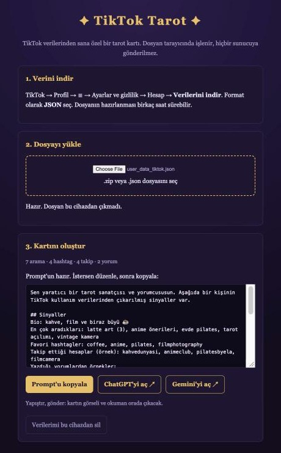

# TikTok Tarot

Builds a personal tarot card prompt from a TikTok data export. The user pastes the prompt into their own ChatGPT or Gemini, which makes the card image and reading. No backend, no API keys.

**Live:** https://kimahmet.github.io/tiktok-tarot/



## Privacy

- The export is parsed in the browser. Nothing is uploaded.
- Direct messages are skipped (`SKIP_KEY` in `core.js`).
- Only the extracted signals (searches, hashtags, followed accounts, comments, bio) are kept, in `localStorage`. The "Verilerimi sil" button removes them.

## Run locally

ES modules do not load from `file://`, so serve the folder:

```sh
python3 -m http.server 8000   # then open http://localhost:8000
```

## Test

```sh
node core.test.mjs
```

## Deploy

Push to GitHub. Then enable Settings → Pages → Deploy from branch → `main` / root.

## Notes

- TikTok's export schema varies between versions. `extractSignals` walks the whole JSON and matches fields by key name. If a real export yields empty signals, check its key names against the regexes in `core.js`.
- Watch history and likes contain only links, no titles, so they are not used.
